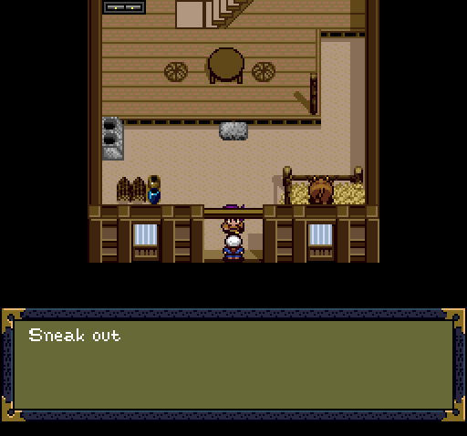

# Tengai Makyou II: Manji Maru (PSP, PC Engine Archives) - English translation

English patch for the PSN release NPJJ30036 of *Far East of Eden: Tengai Makyou II - Manji Maru*.

The released patch carries the PC Engine CD translation ([second-save/tengai-makyou-2-pce-cd](https://github.com/second-save/tengai-makyou-2-pce-cd))
over to the PSP: the PSP's data track is the same disc with a few code changes by Hudson (one far call inserted in
three engine banks, code moved after it; notes in `docs/status.md`), and the PC Engine project's builder has a PSP
mode that follows them. Download and instructions: [Releases](../../releases).

This repo holds the PSP-side tools and research:
- `tools/content.py`: CONTENT.DAT unpack / pack (needs `tools/public.key`, not included: see the script).
- `tools/pce.py` + `tools/lua/`: headless Mesen runs (scripted input, screenshots, RAM dumps, probes).
- `docs/re/notes.md`, `docs/status.md`: reverse-engineering notes and progress.
- An earlier insertion pipeline (`tools/build.py`, `insert.py`, `mainstr.py`...) built on the DS translation.

No game data is included. You need your own copy of the game.
